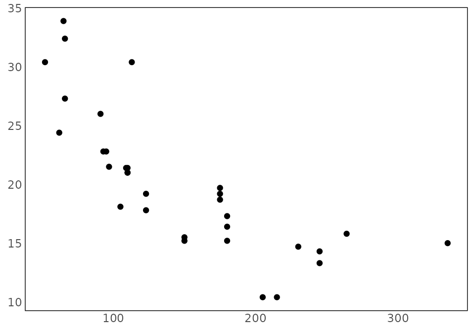

# Getting started with priogridR

`priogridR` provides utilities and general spatial converters for
PRIO-GRID. The package delegates grid construction, configuration, and
core raster alignment to the official `priogrid` package while providing
a consistent `pg_` interface for common input formats.

``` r

library(priogridR)
```

## Grid identifiers

PRIO-GRID identifiers start in the south-western cell and increase
eastward, then northward. The matrix returned by
[`pg_create_indices()`](https://christianoswald.github.io/priogridR/reference/pg_create_indices.md)
is displayed with the northernmost row first:

``` r

pg_create_indices(nrow = 3, ncol = 3)
#>      [,1] [,2] [,3]
#> [1,]    7    8    9
#> [2,]    4    5    6
#> [3,]    1    2    3
```

## Neighboring cells

[`pg_neighbors()`](https://christianoswald.github.io/priogridR/reference/pg_neighbors.md)
returns queen-contiguity neighbors: cells sharing an edge or corner.
Longitude wraps across the antimeridian by default, while latitude does
not wrap across the poles.

``` r

pg_neighbors(5, nrow = 3, ncol = 3)
#> [1] 7 8 9 4 6 1 2 3
pg_neighbors(1, nrow = 3, ncol = 3)
#> [1] 6 4 5 3 2
```

For a grid that should not wrap longitudinally, use:

``` r

pg_neighbors(
  1,
  nrow = 3,
  ncol = 3,
  wrap_longitude = FALSE
)
#> [1] 4 5 2
```

## Reproducible data paths

[`pg_paths()`](https://christianoswald.github.io/priogridR/reference/pg_paths.md)
constructs conventional project paths without changing the working
directory:

``` r

pg_paths(root = tempdir())
#> $root
#> [1] "/tmp/RtmpnjlKdz"
#> 
#> $raw
#> [1] "/tmp/RtmpnjlKdz/data/raw"
#> 
#> $processed
#> [1] "/tmp/RtmpnjlKdz/data/processed"
#> 
#> $temporary
#> [1] "/tmp/RtmpnjlKdz/data/temp"
```

Pass `create = TRUE` when the directories should be created.

## Conversion results

Conversion functions can return:

- a data frame with `return = "data"`;
- a
  [`terra::SpatRaster`](https://rspatial.github.io/terra/reference/SpatRaster-class.html)
  with `return = "raster"`; or
- a `pg_result` containing data, raster, and metadata with
  `return = "result"`.

Use
[`pg_write_result()`](https://christianoswald.github.io/priogridR/reference/pg_write_result.md)
to save supported tabular or raster outputs. See the
conversion-workflows vignette for format-specific examples.

## Plot styling

[`pg_theme()`](https://christianoswald.github.io/priogridR/reference/pg_theme.md)
supplies a minimal map-oriented ggplot2 theme:

``` r

ggplot2::ggplot(
  mtcars,
  ggplot2::aes(x = hp, y = mpg)
) +
  ggplot2::geom_point() +
  pg_theme()
```


