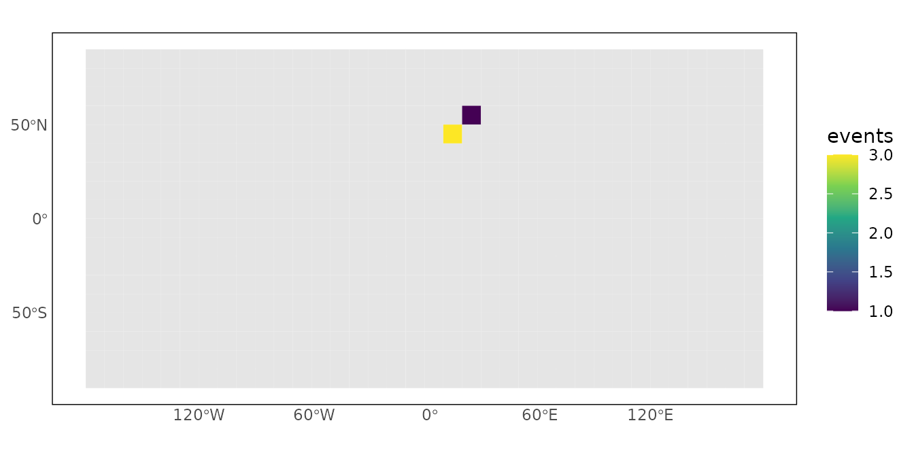

# Grid foundations

``` r

library(priogridR)
```

The foundation functions provide a consistent route from locations to
cells, from cells to geometries, and from incomplete observations to
analysis-ready PRIO-GRID panels. All functions accept a `priogrid`
configuration, so the same workflow can be used with alternative
resolutions and extents.

## Configure a small grid

The examples use a deliberately coarse global grid so they render
quickly.

``` r

config <- priogrid::pg_config(
  nrow = 18,
  ncol = 36,
  start_date = as.Date("2020-12-31"),
  end_date = as.Date("2021-12-31"),
  temporal_resolution = "1 year",
  verbose = FALSE
)
```

## Convert coordinates and cell IDs

[`pg_id_from_coords()`](https://christianoswald.github.io/priogridR/reference/pg_id_from_coords.md)
assigns longitude-latitude coordinates to configured cells. Coordinates
outside a regional grid return `NA` by default.

``` r

cells <- pg_id_from_coords(
  longitude = c(10, 20),
  latitude = c(50, 60),
  config = config
)
cells
#> [1] 488 525
```

Cell centres can be recovered in any requested coordinate reference
system.

``` r

pg_coords_from_id(cells, config = config)
#>   pgid xcoord ycoord
#> 1  488     15     45
#> 2  525     25     55
```

## Create spatial geometries

Use
[`pg_geometry()`](https://christianoswald.github.io/priogridR/reference/pg_geometry.md)
to create polygons for mapping or points for distance and
nearest-feature operations.

``` r

cell_polygons <- pg_geometry(cells, config = config)
cell_centres <- pg_geometry(cells, geometry = "point", config = config)
cell_centres
#> Simple feature collection with 2 features and 1 field
#> Geometry type: POINT
#> Dimension:     XY
#> Bounding box:  xmin: 15 ymin: 45 xmax: 25 ymax: 55
#> Geodetic CRS:  +proj=longlat +datum=WGS84 +no_defs
#>   pgid      geometry
#> 1  488 POINT (15 45)
#> 2  525 POINT (25 55)
```

## Validate and complete data

Validation reports missing or unknown IDs, missing time values,
duplicate panel keys, and—when requested—absent cell-time combinations.

``` r

observations <- data.frame(
  pgid = cells,
  year = c(2020L, 2020L),
  events = c(3L, 1L)
)

pg_validate_data(
  observations,
  time = "year",
  config = config
)
#> PRIO-GRID validation: valid
#> Rows: 2; observed cells: 2
#>                 check    severity   n
#>  missing_combinations information 646
```

[`pg_complete_panel()`](https://christianoswald.github.io/priogridR/reference/pg_complete_panel.md)
makes missing combinations explicit. Fill values are applied only to
rows created by the function; existing `NA` values are left unchanged.

``` r

panel <- pg_complete_panel(
  observations,
  time = "year",
  cells = cells,
  times = 2020:2021,
  fill = list(events = 0L),
  config = config
)
panel
#>   pgid year events
#> 1  488 2020      3
#> 2  525 2020      1
#> 3  488 2021      0
#> 4  525 2021      0
```

## Join variables safely

The default relationship is many-to-one: the right-hand table must
contain at most one row for each inferred grid-time key. State another
relationship only when it is substantively intended.

``` r

cell_attributes <- data.frame(
  pgid = cells,
  region = c("A", "B")
)

panel <- pg_join(panel, cell_attributes, by = "pgid")
panel
#>   pgid year events region
#> 1  488 2020      3      A
#> 2  525 2020      1      B
#> 3  488 2021      0      A
#> 4  525 2021      0      B
```

## Plot a variable

[`pg_plot()`](https://christianoswald.github.io/priogridR/reference/pg_plot.md)
creates a `ggplot2` map and returns it for further customization.

``` r

pg_plot(
  panel,
  variable = "events",
  time = "year",
  time_value = 2020L,
  config = config
)
```


