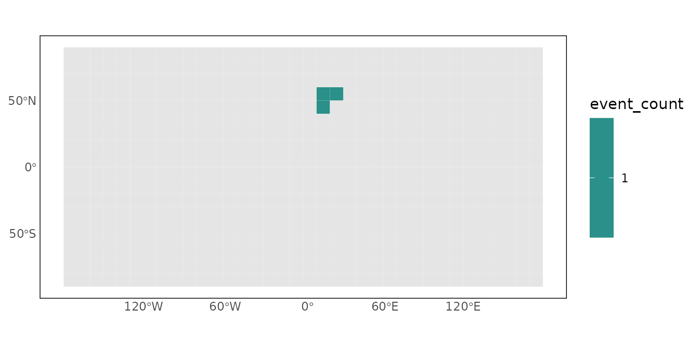
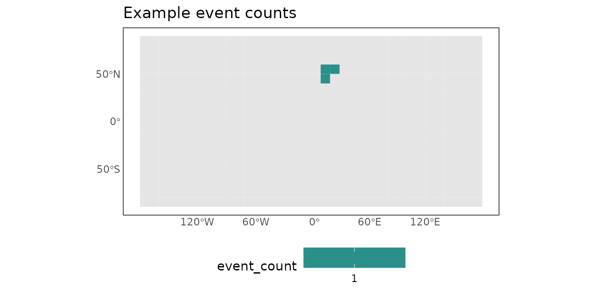

# Results, output, and visualization

``` r

library(priogridR)
```

The conversion functions can return ordinary data frames, rasters, or a
structured `pg_result`. The workflow helpers make it easier to organize,
inspect, save, and visualize those outputs consistently.

## Reproducible project paths

[`pg_paths()`](https://christianoswald.github.io/priogridR/reference/pg_paths.md)
constructs conventional raw, processed, and temporary data paths without
changing the working directory.

``` r

project_root <- file.path(tempdir(), "priogridR-vignette-project")
paths <- pg_paths(project_root, create = TRUE)
paths
#> $root
#> [1] "/tmp/RtmpRF6GuY/priogridR-vignette-project"
#> 
#> $raw
#> [1] "/tmp/RtmpRF6GuY/priogridR-vignette-project/data/raw"
#> 
#> $processed
#> [1] "/tmp/RtmpRF6GuY/priogridR-vignette-project/data/processed"
#> 
#> $temporary
#> [1] "/tmp/RtmpRF6GuY/priogridR-vignette-project/data/temp"
```

The returned list can be passed directly to
[`file.path()`](https://rdrr.io/r/base/file.path.html) when creating
input or output filenames.

## Structured conversion results

Request `return = "result"` when both the converted data and its
metadata are useful.

``` r

events <- data.frame(
  longitude = c(10, 10.1, 20),
  latitude = c(50, 50.1, 60)
)

config <- priogrid::pg_config(nrow = 18, ncol = 36, verbose = FALSE)

event_result <- pg_from_points(
  events,
  variable = "event_count",
  longitude = "longitude",
  latitude = "latitude",
  aggregation = "count",
  return = "result",
  config = config
)

event_result
#> <pg_result>
#>   Rows: 3
#>   Raster layers: 1
#>   Variable: event_count
```

The ordinary tabular representation is available through
[`as.data.frame()`](https://rdrr.io/r/base/as.data.frame.html).

``` r

event_data <- as.data.frame(event_result)
head(event_data)
#>   pgid event_count
#> 1  488           1
#> 2  524           1
#> 3  525           1
```

## Write outputs

[`pg_write_result()`](https://christianoswald.github.io/priogridR/reference/pg_write_result.md)
selects the writer from the filename extension. Data frames and tabular
`pg_result` objects support CSV, RDS, and—when `arrow` is
installed—Parquet. Rasters support TIFF and VRT.

``` r

csv_file <- file.path(paths$temporary, "event-counts.csv")
pg_write_result(event_result, csv_file, overwrite = TRUE)
utils::read.csv(csv_file)
#>   pgid event_count
#> 1  488           1
#> 2  524           1
#> 3  525           1
```

Use explicit overwrite permission in reproducible scripts when replacing
an earlier output is intended.

``` r

pg_write_result(raster_result, "data/processed/variable.tif", overwrite = TRUE)
```

## Plot grid data

[`pg_plot()`](https://christianoswald.github.io/priogridR/reference/pg_plot.md)
joins a variable to configured cell polygons and returns an ordinary
`ggplot2` object.

``` r

map <- pg_plot(event_data, "event_count", config = config)
map
```



Add layers or replace theme components as with any other ggplot.
[`pg_theme()`](https://christianoswald.github.io/priogridR/reference/pg_theme.md)
can also be used independently.

``` r

map +
  ggplot2::labs(title = "Example event counts") +
  pg_theme(legend.position = "bottom")
```



Temporary example files are removed when the R session ends. In a real
project, use a persistent project root and keep raw and processed data
in separate directories.
